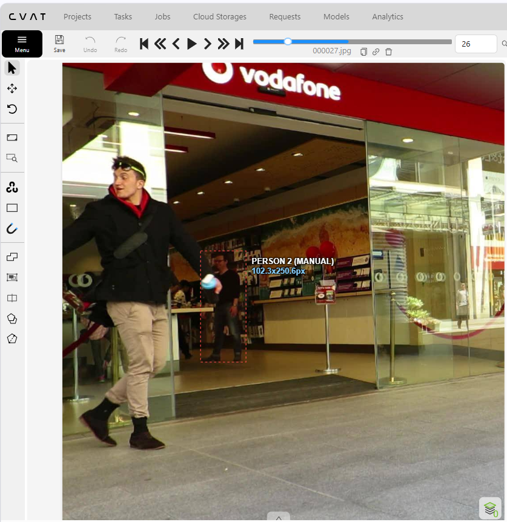
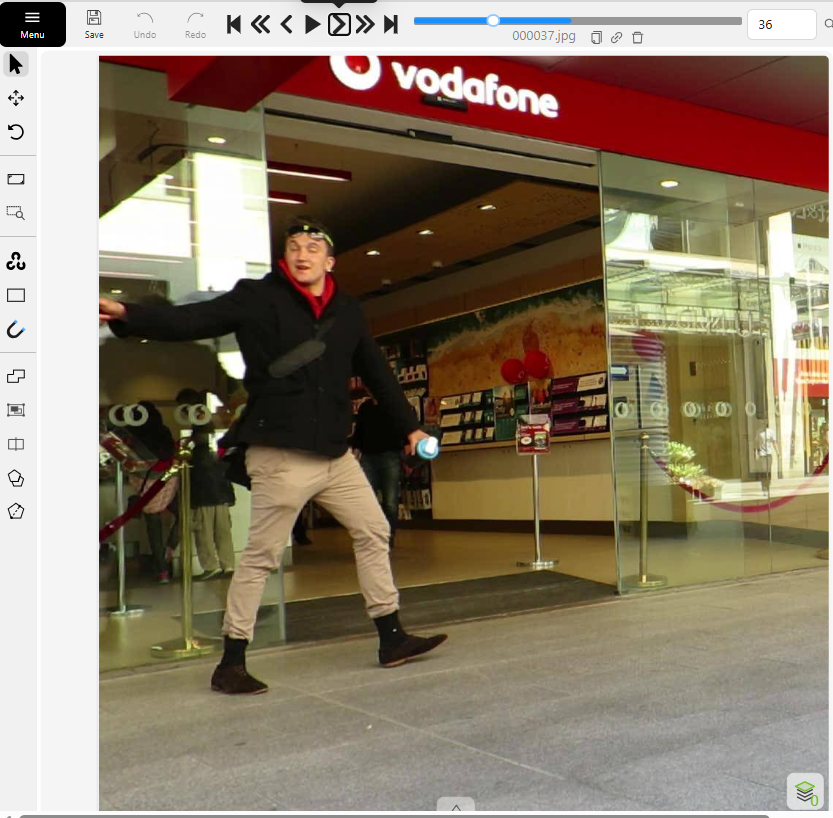
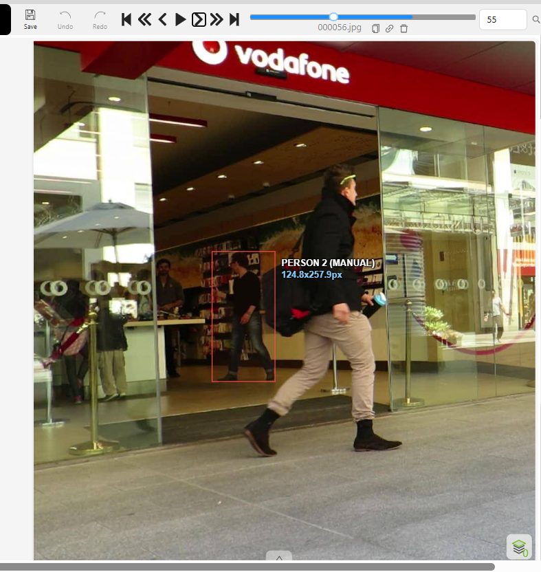

# Báo cáo cá nhân — HoVaTen-MSSV

Đổi tên file theo quy tắc `MSSV_HoTen.md`. Ví dụ: `20241234_NguyenVanAn.md`.

Đoạn video: MOT17-09, 150 frame (frame 1–150), nguồn MOTChallenge, giấy phép CC BY-NC-SA 3.0.

## 0. Thông tin học viên

- Họ tên:Trần Đức Hòa
- MSSV:2A202603181
- Mã đề (A/B/C):B
- Email:26ai.hoatd@vinuni.edu.vn
- Link repository:https://github.com/TranDHoa/K5-L2A-DAY05-TranDucHoa-2A202603181-MOTTracking
- Giờ bắt đầu: 4h45
- Giờ kết thúc: 7h30

## 1. Xem trước đoạn video (CP0)

Ghi **trước khi vẽ**, mỗi người một dòng.

| Mã | Frame xuất hiện | Frame cuối thấy được | Rẽ / dừng / đổi tốc độ ở frame | Bị che ở frame | Ghi chú |
|---|---|---|---|---|---|
| P1 | 1 | 150 | 70 | 37-54 | |
| P2 | 1 | 150 | Không có | Không có | |
| P3 | 40 | 150 | Không có | Không có | |
| P4 | 1 | 145 | 30 | 110 - 138, 145 - 150| |
| P5 | 2 | 105 | 30 | 106 - 150 | |

## 2. Keyframe và thời gian (CP1, CP4)

Số keyframe lấy từ kết quả `src/check_submission.py`.

| Mã | Số keyframe | Keyframe ở frame | Số frame có mặt | Keyframe / 100 frame | Thời gian (phút) | Chỗ khó |
|---|---|---|---|---|---|---|
| P1 | 33 |  [0, 10, 20, 26, 30, 54, 55, 60, 62, 64, 70, 72, 73, 74, 75, 76, 77, 80, 88, 89, 90, 91, 99, 100, 102, 110, 111, 120, 130, 140, 142, 145, 149] | 132 | 25.0 | 20 | Đoạn bị che |
| P2 | 30 | [0, 10, 20, 30, 40, 50, 60, 63, 64, 67, 70, 75, 80, 84, 90, 92, 100, 102, 103, 110, 120, 121, 122, 124, 126, 130, 133, 140, 144, 149] | 150 | 10 | 20 | |
| P3 | 16 | [40, 50, 53, 54, 60, 70, 80, 90, 93, 100, 110, 120, 124, 129, 130, 149] | 110 | 14.5 | 10 | |
| P4 | 13 | [0, 10, 20, 30, 40, 50, 60, 100, 106, 138, 140, 141, 142] | 117 | 11.1 | 25 | |
| P5 | 9 |  [2, 10, 20, 30, 40, 50, 60, 89, 100] | 103 | 8.7 | 15 | |
| **Tổng** | 101 | | 612 | 16.5 | | |

Keyframe / 100 frame của cả bài = tổng keyframe ÷ tổng số frame có mặt × 100 = 101 ÷ 612 × 100 = 16.5

Bạn đặt keyframe nhiều nhất ở người nào? Vì sao (người đó rẽ, dừng, lại gần camera hay bị che)?
- P1 có số keyframe nhiều nhất với 33 keyframe, tương đương 25.0 keyframe trên 100 frame có mặt. Track này có đoạn mất dấu từ frame 36 đến frame 53. Các keyframe được bổ sung khi người xuất hiện trở lại và ở những đoạn cần hiệu chỉnh nội suy. Việc đặt thêm keyframe giúp bounding box bám sát vị trí và kích thước người trong video
...

## 3. Đoạn bị che (CP2)

Người bị che: `P1`

| Mốc | Frame |
|---|---:|
| Bắt đầu bị che một phần (bật `occluded`) | 27 |
| Mất hẳn (bật `outside`) | 37 |
| Hiện lại (tắt `outside`) | 55 |
| Thấy rõ trở lại (tắt `occluded`) | 56 |

- Thời gian khuất hẳn: 18 frame = 0.6 giây.
- Quyết định: giữ cùng ID.
- Lý do (trả lời 3 câu: khuất bao lâu so với 60 frame, ngoại hình có khớp, chỗ hiện lại có đúng hướng và tốc độ):
+ P1 biến mất hoàn toàn trong 18 frame, ngắn hơn ngưỡng 60 frame  theo guideline. Vì vậy, nếu ngoại hình và hướng di chuyển khi xuất hiện lại khớp với trước khi khuất, tôi tiếp tục sử dụng track ID cũ, không tạo track mới.
...

Ảnh chụp màn hình:

## 4. Tự review ID (CP3)

Lượt 1 theo người (đi ngược từ frame 149 về 0 trên CVAT), lượt 2 theo cảnh (nhảy 10 frame). Ít nhất 3 dòng; không có lỗi thì ghi một dòng "đã kiểm hai lượt, không lỗi".

Loại lỗi dùng đúng một trong 7 mã: `id_switch`, `fragmentation`, `lost`, `merge`, `false_track`, `drift`, `flag`.

| Frame | Mã người | Loại lỗi | Mô tả một câu | Phát hiện ở lượt | Đã sửa? |

|---:|---|---|---|---|---|
| | | | | | |
| | | | | | |
| | | | | | |

Tổng hợp số lỗi theo loại:

| `id_switch` | `fragmentation` | `lost` | `merge` | `false_track` | `drift` | `flag` |
|---:|---:|---:|---:|---:|---:|---:|
| | | | | | | |

Lỗi nào chỉ lượt 2 (theo cảnh) mới thấy, lượt 1 (theo người) không thấy? Vì sao?
- Đã kiểm hai lượt, không lỗi
...

## 5. File xuất và kết quả tự kiểm (CP4)

| Kiểm tra | Kết quả |
|---|---|
| Tên file MOT 1.1 | TranDucHoa_mot.zip |
| Tên file CVAT for video 1.1 | TranDucHoa_cvat_video.zip |
| Số track ID khác nhau trong `gt/gt.txt` (phải là 5) | 5 |
| Frame `outside` không có dòng trong `gt.txt` (đúng / sai) | Đúng |
| Job đã completed trên CVAT máy cá nhân | Xác nhận |

Dán phần tóm tắt in ra từ `src/check_submission.py`:

  Lỗi: 0   |   Cảnh báo: 0
  Đạt. Dán phần tóm tắt này vào báo cáo mục 5.

## 6. Ba câu kết

1. Nếu được gán lại, bạn sẽ đặt keyframe khác ở đâu? Vì sao?
- Nếu được gán lại, tôi sẽ tập trung điều chỉnh keyframe ở P1, đặc biệt trong khoảng frame 54–80 theo cách đánh số CVAT.

- Đây là đoạn P1 xuất hiện trở lại sau khi bị che khuất hoàn toàn. Khi xuất hiện lại, vị trí và kích thước bounding box có thể khác đáng kể so với trước khi biến mất.

- Tôi sẽ kiểm tra các frame liên tiếp để bổ sung hoặc điều chỉnh keyframe tại những vị trí nội suy tuyến tính chưa bám sát người. Việc này giúp hạn chế lỗi drift và nâng cao độ chính xác của bounding box.
   ...

2. Có chỗ nào bạn không chắc "cùng ID hay ID mới"? Bạn đã quyết định và ghi chú thế nào?
- Trường hợp khó xác định nhất là P5 khi bị che khuất.
- P5 biến mất từ frame 100 đến 150 tương đương 50 frame. Còn theo guildline là 60 frame nên chưa tạo id mới.
   ...

3. Một lỗi ID trong job của bạn (nếu không còn sót, chọn lỗi đã sửa) có thể làm xe tự lái dự đoán sai chuyển động của người đó như thế nào? Lỗi đó ảnh hưởng MOTA hay IDF1 nhiều hơn?
- Một lỗi nghiêm trọng có thể xảy ra là id_switch, khi hệ thống nhầm danh tính giữa hai người đi bộ.

- Ví dụ, nếu một người đang di chuyển từ trái sang phải nhưng ID của họ bị chuyển sang một người ở vị trí khác, hệ thống có thể tính toán sai hướng và vận tốc di chuyển.

- Trong hệ thống ADAS, điều này có thể khiến thuật toán dự đoán quỹ đạo đánh giá sai nguy cơ va chạm, từ đó đưa ra quyết định cảnh báo hoặc phanh không phù hợp.

- Lỗi id_switch ảnh hưởng đến cả MOTA và IDF1. Tuy nhiên, IDF1 phản ánh trực tiếp hơn chất lượng duy trì danh tính xuyên suốt quá trình theo dõi, trong khi MOTA tổng hợp các lỗi phát hiện thiếu, phát hiện thừa và chuyển đổi ID.
   ...

## Bonus (nếu làm)

### B1 — Hai người đi sát

...

### B2 — So cách đặt keyframe

| Cách đặt | Số keyframe | Frame trôi nhất | Ghi chú |
|---|---:|---:|---|
| Đều mỗi 30 frame | | | |
| Theo chỗ đổi hướng | | | |

...

### B3 — So với tracker có sẵn

| Frame | Mã người | Tracker làm gì | Nhãn của bạn | Giải thích (đoán rồi sửa / ghép IoU / box score thấp / ngoại hình) |
|---:|---|---|---|---|
| | | | | |
| | | | | |

## 7. Tài liệu tham khảo và công cụ AI đã dùng
MOTChallenge — MOT17 Dataset: https://motchallenge.net/

CVAT Documentation: https://docs.cvat.ai/

docs/GUIDELINE.md — Quy ước gán nhãn của lớp.

docs/MOT_FORMAT.md — Định dạng MOT 1.1 và các chỉ số đánh giá.

CHECKPOINTS.md — Yêu cầu thực hành CP0–CP4.

Nguồn dữ liệu: MOT17, MOTChallenge (Milan et al., 2016), giấy phép CC BY-NC-SA 3.0.

Công cụ AI đã sử dụng

Công cụ: ChatGPT (OpenAI).

Mục đích sử dụng:

Giải thích cách sử dụng CVAT Track Mode, keyframe và nội suy tuyến tính.

Hỗ trợ phân biệt occluded và outside.

Giải thích quy tắc giữ ID khi người bị che khuất dưới 60 frame.

Hỗ trợ đọc kết quả check_submission.py.

Hỗ trợ trình bày báo cáo, tính toán tỷ lệ keyframe và giải thích MOTA, IDF1.

Phạm vi thực hiện cá nhân: Việc xác định đối tượng, gán bounding box, đặt keyframe, xử lý track ID và tự review trên CVAT do học viên thực hiện....
